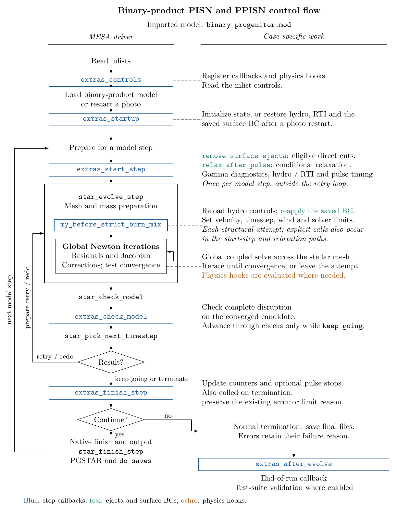
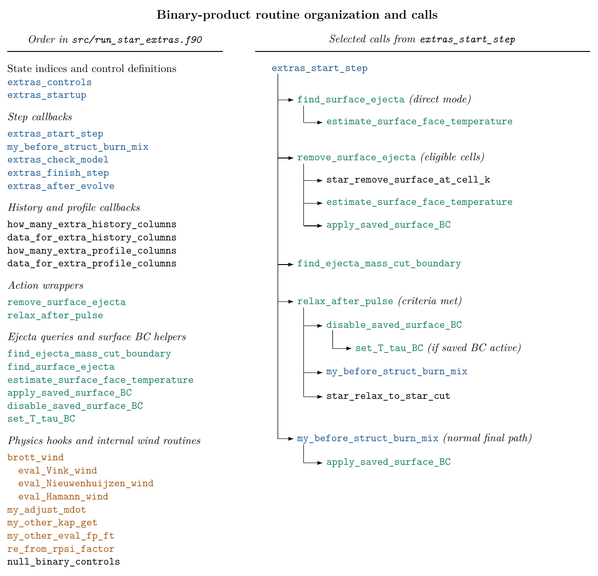

.. _dev_TDC_ppisn_from_binary:

**************************
dev_TDC_ppisn_from_binary
**************************

.. tags:: star, very-massive-star, helium-star, pair-instability, pulsational-pair-instability

This development case follows pulsational pair instability in a star
produced by the sibling ``binary_ppisn_progenitor`` calculation (see
|Marchant2019|). It is a single-star pulse calculation; it does not evolve the
binary or construct the progenitor in this directory.

.. |Marchant2019| replace:: `Marchant et al. 2019 <https://ui.adsabs.harvard.edu/abs/2019ApJ...882...36M/abstract>`__

Model handoff
=============

``inlist_pulses`` loads the saved model selected by ``load_model_filename``
from the binary progenitor case. The included ``accretor_postHe.mod`` is an
intermediate binary-evolution snapshot and is not the default starting model
selected by ``./rn``.

Run sequence
============

Running ``./rn`` selects ``inlist_pulses_header`` with ``MESA_INLIST``, loads
the binary product with velocity enabled, and writes ``final.mod`` when the
development run terminates. Running ``./re`` restarts the newest photo with
the same pulse inlist.

``inlist_ppisn`` contains the persistent pulse physics.
``run_star_extras`` switches between ``inlist_hydro_on`` and
``inlist_hydro_off`` and removes unbound surface ejecta directly. The model
continues through successive pulses until core collapse or complete
disruption. Setting ``x_logical_ctrl(1) = .true.`` enables an early stop
100 days after the first relaxation or at the onset of the second pulse.
This option is disabled by default. The pulse calculation has no required
termination code, and ``max_model_number = -1`` leaves the model number
unrestricted.
MESA saves ``final.mod`` at normal termination; ``./rn`` does not
require this file to declare a run successful.

The onset is identified by the gamma integral becoming negative, recovering
to a positive value, then becoming negative again. The integral is evaluated
at the start of the step and checked after the step is accepted. Enable the
option before the first pulse; photo restarts then preserve the phase. The
phase is not tracked when the option is disabled.

The BC values after direct surface removal are saved in photos and
reapplied at startup and before each solve. They remain active if further
direct removal is disabled. The relaxation path restores the normal
atmosphere.

Control flow
============

The diagrams show an imported binary product evolved as a single star.
``binary_progenitor.mod`` is a generic input label in the figure; the actual
filename is selected in ``inlist_pulses``. The callback organization is the
same as in the single-star dev case.

From the parent ``ppisn_models`` directory, run ``python plotter/plot.py``
to regenerate both dev variants and refresh the single-star test-suite
copies. The shared source is ``plotter/main.tex``. This requires pdfLaTeX
with TikZ and ``pdftoppm`` from Poppler.

Last-Updated: 2026-08 by EbF
