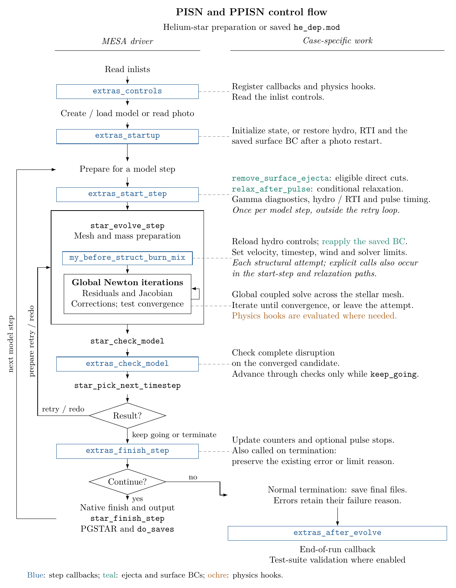
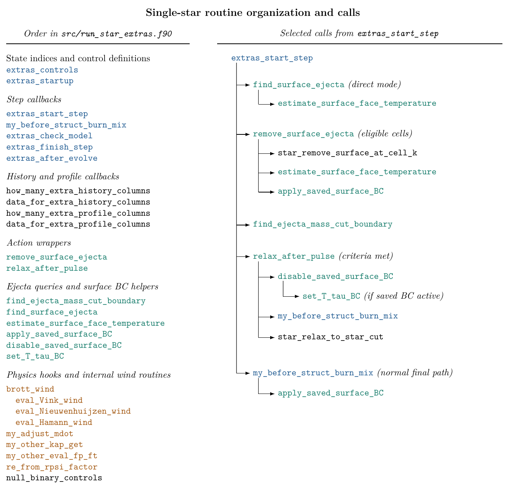

.. _dev_TDC_single_star_ppisn:

**************************
dev_TDC_single_star_ppisn
**************************

.. tags:: star, very-massive-star, helium-star, pair-instability, pulsational-pair-instability

This development case evolves an isolated :math:`72.5\,M_\odot` helium star
from the pre-main sequence through helium depletion and then follows
successive pulsational pair-instability events (see |Marchant2019|).

.. |Marchant2019| replace:: `Marchant et al. 2019 <https://ui.adsabs.harvard.edu/abs/2019ApJ...882...36M/abstract>`__

Run sequence
============

Running ``./rn`` selects each part explicitly with ``MESA_INLIST``:

1. ``inlist_to_he_dep_header`` creates the helium star using the mass and
   metallicity in ``inlist_extra``. It stops at a central helium mass fraction
   of :math:`10^{-3}` and writes ``he_dep.mod``.
2. ``inlist_pulses_header`` loads ``he_dep.mod`` with velocity enabled and
   writes the final state to ``final.mod`` when the development run
   terminates.

Setting ``MESA_SKIP_OPTIONAL`` uses ``standard_he_dep.mod`` instead of
rebuilding the helium-depleted model. Running ``./re`` restarts the newest
photo with the pulse inlist.

Configuration
=============

``inlist_ppisn`` contains the persistent pulse physics. ``run_star_extras``
loads ``inlist_hydro_on`` and ``inlist_hydro_off`` as the model enters and
leaves Riemann hydrodynamics, removes unbound surface ejecta directly, and
continues through successive pulses until core collapse or complete
disruption. Setting ``x_logical_ctrl(1) = .true.`` enables an early stop
100 days after the first relaxation or at the onset of the second pulse.
This option is disabled by default. The pulse calculation has no required
termination code, and ``max_model_number = -1`` leaves the model number
unrestricted.
MESA saves ``final.mod`` at normal termination; ``./rn`` does not
require this file to declare a run successful.

The onset is identified by the gamma integral becoming negative, recovering
to a positive value, then becoming negative again. The integral is evaluated
at the start of the step and checked after the step is accepted. Enable the
option before the first pulse; photo restarts then preserve the phase. The
phase is not tracked when the option is disabled.

The BC values after direct surface removal are saved in photos and
reapplied at startup and before each solve. They remain active if further
direct removal is disabled. The relaxation path restores the normal
atmosphere.

Control flow
============

The diagrams show the single-star model preparation and shared pulse
callbacks. The optional stopping control described above is disabled by
default in this dev case.

From the parent ``ppisn_models`` directory, run ``python plotter/plot.py``
to regenerate the local figures and refresh their test-suite copies. The
shared source is ``plotter/main.tex``. This requires pdfLaTeX with TikZ
and ``pdftoppm`` from Poppler.

Last-Updated: 2026-08 by EbF
