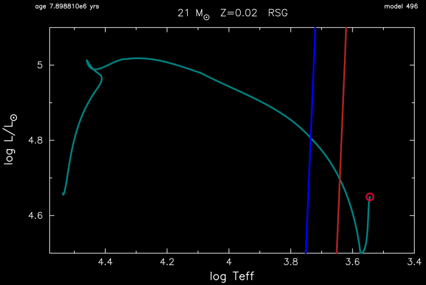

.. _gyre_in_mesa_rsg:

****************
gyre_in_mesa_rsg
****************

.. tags:: star, gyre, asteroseismology, p-mode, massive-star, red-supergiant

This test case checks the implementation of GYRE in MESA for a 21 |Msun|, Z=0.02 metallicity, model in the red supergiant regime.

This test case has 4 parts.

* Part 1 (``inlist_to_zams``) builds a 21.0 |Msun|, Z=0.02 metallicity, pre-main sequence model and evolves it to the main sequence.

* Part 2 (``inlist_to_near_pulses``) continues the evolution until effective temperature goes below log10(Teff/K) = 3.55.

* Part 3 (``inlist_to_pulse``) continues the evolution until luminosity exceeds log10(Lsun/L) = 5.04.

* Part 4 (``inlist_gyre_in_mesa_rsg``) continues the evolution for 20 timesteps. During the evolution the ``run_star_extras.f90`` calls GYRE, processes the GYRE output, and searches for a p-mode frequency of 2.430e-8 Hz (24.30 nanoHz). Close matches to this target frequency are reported in the terminal:

.. code-block:: console

   model   order           freq (Hz)             P (sec)             P (day)        growth (day)              growth    cycles to double
       2       1          0.2430E-07       41155329.1654            476.3348          14811.2911              0.0322             31.0943
 matched target frequency

 ...

   model   order           freq (Hz)             P (sec)             P (day)        growth (day)              growth    cycles to double
      20       1          0.2584E-07       38698796.5952            447.9027          15271.3871              0.0293             34.0953

Last-Updated: 03Nov2026 (MESA 9dc715cca) by EbF.
