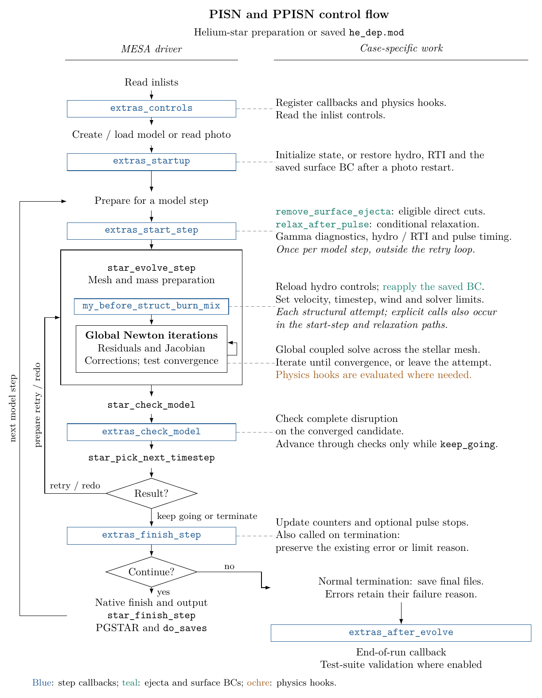
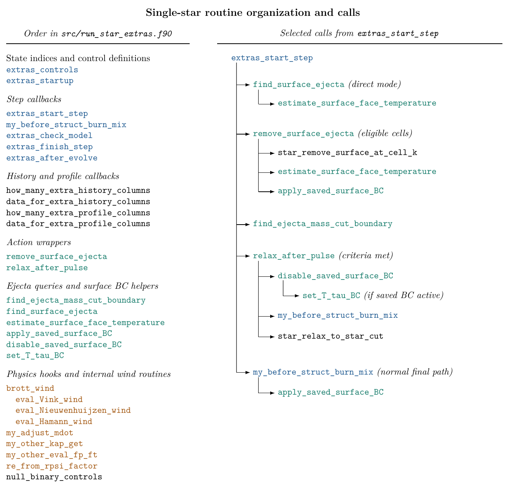

.. _pisn:

****
pisn
****

.. tags:: star, very-massive-star, helium-star, pair-instability, pair-instability-supernova, supernova, explosive-burning

This test evolves a :math:`200\,M_\odot` helium star at :math:`Z = 1.6\times10^{-3}`
through a pair-instability supernova. It uses the same helium-star evolution
setup as :ref:`ppisn`, but stops at complete disruption rather than using
the PPISN pulse limits.

Run sequence
============

Running ``./rn`` performs two parts:

1. ``inlist_to_he_dep_header`` creates the helium star and evolves it until
   the central helium mass fraction falls below :math:`10^{-3}`. It writes
   ``he_dep.mod`` and refreshes ``standard_he_dep.mod``.
2. ``inlist_pulses_header`` loads ``he_dep.mod`` and evolves through the
   instability and disruption, writing ``final.mod`` on termination.

Setting ``MESA_SKIP_OPTIONAL`` skips the first part when
``standard_he_dep.mod`` is available. Otherwise, the first part builds it.

Physical checks
===============

The required termination is ``Successful test: PISN disruption``.
The disruption check requires ``q(k_keep) <= 1d-3`` and
outward velocities at least as large as the local escape velocity in
every cell from ``k_keep`` to the surface. A positive total energy alone
does not satisfy this check. The test also requires a recorded
pair-instability onset.

Disruption is checked in ``extras_check_model`` after a model is accepted.
Normal termination writes ``final.mod`` and ``LOGS/pisn_prof.data``. The
model file records the expanding star; it does not represent a bound remnant.

The TestHub diagnostic ``gamma1_cntr_pulse_start`` records the central
:math:`\Gamma_1 - 4/3` when the whole-star pressure-weighted average first
becomes negative during the pulse calculation. The value and its flag are
stored in ``xtra`` and ``lxtra`` so they survive photo restarts.

The BC values after direct surface removal are saved in photos and
reapplied at startup and before each solve. They remain active if further
direct removal is disabled. The relaxation path restores the normal
atmosphere.

The stop 100 days after relaxation is disabled. Collapse and the model
number limit of 6000 do not count as successful PISN termination.

Configuration
=============

``inlist_extra`` sets ``initial_mass = 200d0``,
``initial_Z = Zbase = 1.6d-3``, and ``initial_Y = 0.9984d0``.
The other physics and solver controls follow the PPISN test, including
level 3 gold tolerances of ``1d3`` above ``x_ctrl(23) = 5d9``.

The inlist profile interval is 200 models. ``run_star_extras`` retains its
100-model interval and 10-model interval near breakout.

Control flow
============

The diagrams show the shared single-star step loop and routine organization.
The PISN onset and disruption checks described above remain specific to this
case.

The shared TikZ source and generator are in
``star/dev_cases_test_TDC/ppisn_models/plotter``. From ``ppisn_models``, run
``python plotter/plot.py`` to refresh the local PNG copies in ``docs``.
This requires pdfLaTeX with TikZ and ``pdftoppm`` from Poppler.

Last-Updated: 2026-09 by EbF
