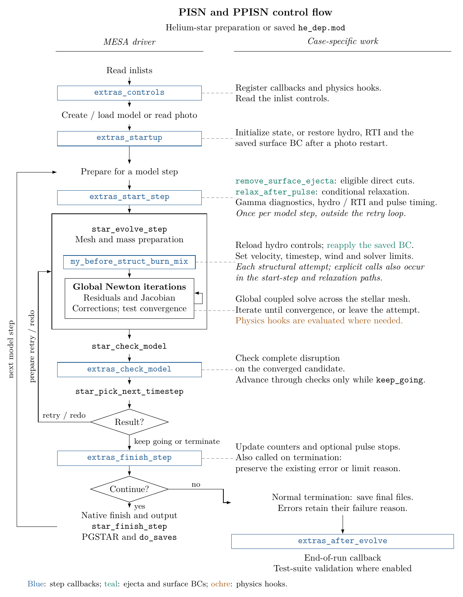
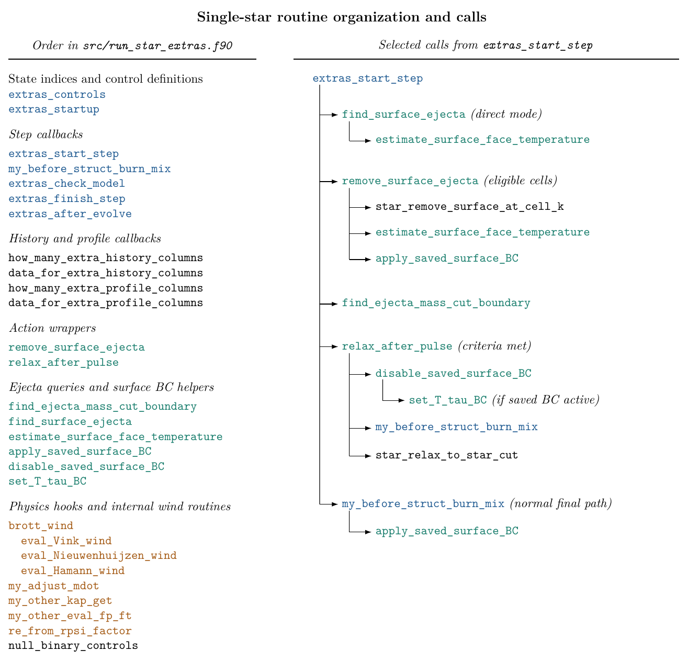

.. _ppisn:

*****
ppisn
*****

.. tags:: star, very-massive-star, helium-star, pair-instability, pulsational-pair-instability

This test evolves a :math:`72.5\,M_\odot` helium star at :math:`Z = 0.00142`
through pulsational pair instability (see |Marchant2019|).

.. |Marchant2019| replace:: `Marchant et al. 2019 <https://ui.adsabs.harvard.edu/abs/2019ApJ...882...36M/abstract>`__

Run sequence
============

Running ``./rn`` performs two parts:

1. ``inlist_to_he_dep_header`` creates the helium-star model and evolves it
   until the central helium mass fraction falls below :math:`10^{-3}`. It
   writes ``he_dep.mod`` and refreshes ``standard_he_dep.mod``.
2. ``inlist_pulses_header`` loads ``he_dep.mod`` with velocity enabled,
   follows the pulses and removes unbound surface ejecta. The bound remnant
   is relaxed if the conditions in ``run_star_extras`` are met.

Setting ``MESA_SKIP_OPTIONAL`` skips the first part and copies
``standard_he_dep.mod`` to ``he_dep.mod``.

The pulse calculation stops 100 days after the first relaxation or at the
onset of the second pulse, whichever occurs first. Stopping at the second
pulse requires prior mass removal by direct cuts or relaxation. Both
termination codes are accepted by the test.

The second pulse onset is defined here by the gamma integral becoming
negative, recovering to a positive value, then becoming negative again.
This integral is the pressure weighted average of
:math:`\Gamma_1 - 4/3` over the selected bound layers, evaluated at the start
of the step. The stop checks this stored value after the step is accepted.
The pulse phase is saved in photos. When using older photos, restart from
before the first pulse. Reaching the second onset without prior mass removal
fails the test.

Configuration
=============

``inlist_ppisn`` contains the shared pulse physics. ``inlist_hydro_on`` and
``inlist_hydro_off`` are loaded by ``run_star_extras`` when the model enters
and leaves Riemann hydrodynamics.

The BC values after direct surface removal are saved in photos and
reapplied at startup and before each solve. They remain active if further
direct removal is disabled. The relaxation path restores the normal
atmosphere.

The initial composition has ``initial_Y = 0.99858d0`` and no hydrogen.
The pulse calculation uses TDC with ``TDC_include_eturb_in_energy_equation = .false.``,
``approx21_cr60_plus_co56.net``, the deBoer
:math:`{}^{12}\mathrm{C}(\alpha,\gamma){}^{16}\mathrm{O}` rate, and
``mass_fraction_limit_for_Skye = 1d-8``. Level 3 gold tolerances relax to
``1d3`` above the temperature set by ``x_ctrl(23) = 5d9`` during evolution,
not during model relaxation.

The inlist profile interval is 200 models. ``run_star_extras`` writes profiles
every 100 models and every 10 models near breakout. The model number limit
is 6000. Reaching this limit does not count as a successful termination.

Control flow
============

The diagram below follows the current driver and the PISN/PPISN callbacks.
It is based on Josiah Schwab's `MESA control-flow diagram
<https://docs.mesastar.org/en/latest/using_mesa/extending_mesa.html#control-flow>`__.
The retry loop repeats the structural attempt and its before-solve hook,
but does not repeat ``extras_start_step``. The global Newton iterations
are inside the structural solve, after ``my_before_struct_burn_mix``.
The direct-cut and post-pulse relaxation wrappers are called from
``extras_start_step``, outside that retry loop.

The second diagram shows the implemented routine order and selected calls.
The callbacks are followed by output routines, the ``remove_surface_ejecta``
and ``relax_after_pulse`` wrappers, and the existing helpers and physics hooks.
The wrappers call MESA's native removal and relaxation routines. Eligibility
conditions remain in ``extras_start_step``. A successful relaxation is
followed by gamma bookkeeping and an early return before the final explicit
before-solve hook call. The normal subsequent timestep attempt still invokes
the registered before-solve hook.

The shared TikZ source and generator are in
``star/dev_cases_test_TDC/ppisn_models/plotter``. From ``ppisn_models``, run
``python plotter/plot.py`` to regenerate both dev variants and copy the
single-star figures into this case and ``pisn``. This requires pdfLaTeX
with TikZ and ``pdftoppm`` from Poppler. The README uses the local PNG
copies in ``docs``.

Last-Updated: 2026-09 by EbF
